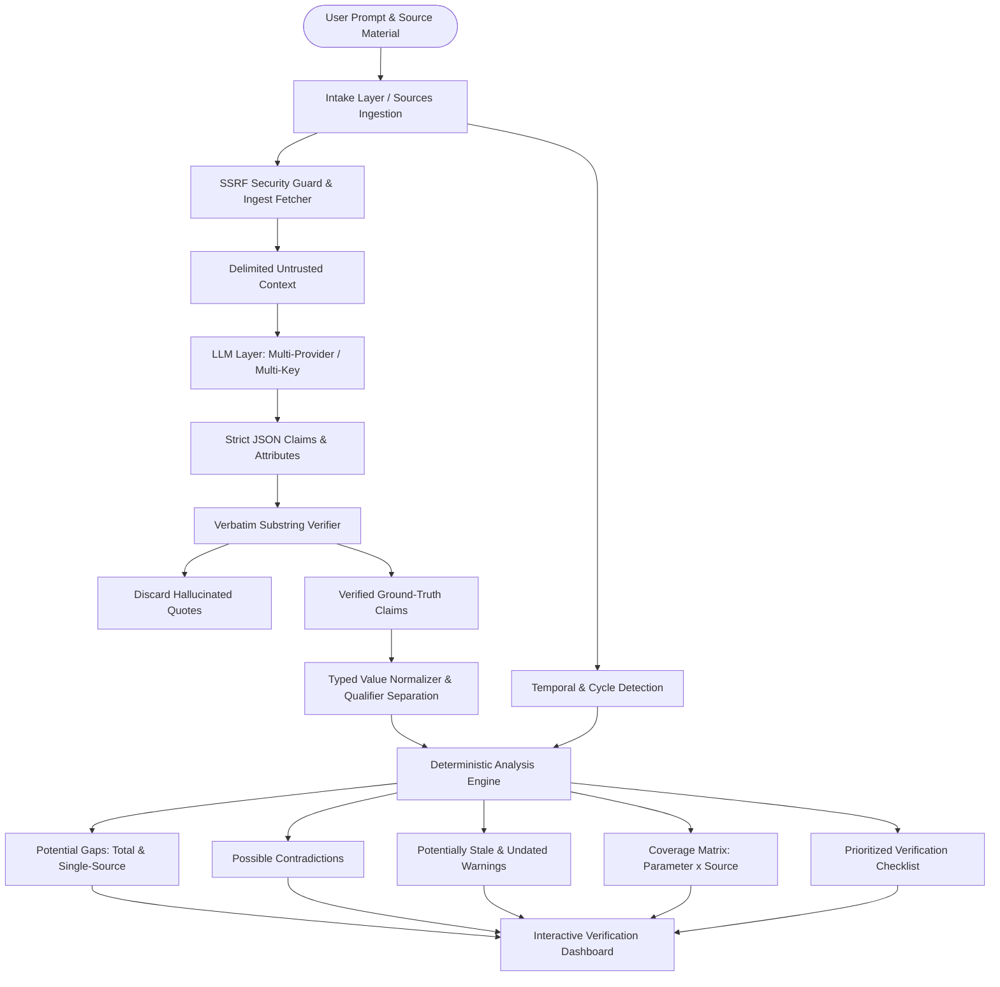

# Digital Dark Spot 🍉
> **AI-Assisted Information Gap & Contradiction Detection Platform**  
> *Built for the Shinchan Online Hackathon 2026 (Devengers)*

[](https://www.typescriptlang.org/)
[](https://react.dev/)
[](https://tailwindcss.com/)
[](https://motion.dev/)
[](docs/EVAL.md)
[](#5-security--secret-protection)

---

## 🏆 How Judges Can Run the Website on Their Laptop

You can clone, install, and run **Digital Dark Spot** locally on Windows, macOS, or Linux in under 2 minutes:

### 1. Prerequisites
- **Node.js**: `v18.0.0` or higher (`v20+` LTS recommended).
- **npm**: `v9+` or higher (installed with Node.js).
- **Git**

### 2. Clone & Install
```bash
# Clone the repository
git clone https://github.com/Akshat-coder-101/Digital-Dark-Spot.git
cd Digital-Dark-Spot

# Install all workspace dependencies (root, backend, and frontend)
npm install
```

### 3. Start the Web Platform
```bash
# Start both Backend (port 3001) and Frontend (port 5173) concurrently:
npm run dev
```

Open your browser to:  
👉 **[http://localhost:5173](http://localhost:5173)**

---

### 4. Zero-Key Offline Demo (No API Keys Needed)

Digital Dark Spot is built with a **100% zero-configuration offline demo mode** so judges can evaluate the platform instantly without entering any API keys:

1. Open **[http://localhost:5173](http://localhost:5173)**.
2. Under the question box on the homepage, click any of the **3 Verified Sample Scenarios**:
   - **Sample A: Aurora Merit Scholarship** — Evaluates conflicting income eligibility rules (₹6,00,000 vs ₹2,50,000), missing disbursement timeline gaps, and expired application cycles.
   - **Sample B: SolarBridge Rooftop Subsidy 2026** — Analyzes clean-energy solar subsidies, benchmark cost ceilings, and mandatory vendor empanelment requirements.
   - **Sample C: Nimbus Air 14 vs Nimbus Air 16** — Compares hardware engineering specs, power limits (TGP), VRAM configurations, and thermal dissipation differences.
3. The platform executes the complete verification engine and renders:
   - **Executive Summary:** Bullet-based findings tied directly to verified source claims.
   - **Key Facts Table:** Up to 12 canonical decision parameters with status chips (`Found`, `Conflict`, `Single source`, `Gap`, `Stale`). Clicking any row opens the verbatim evidence drawer.
   - **Key Dates Timeline:** Chronological milestone and deadline tracker with `Passed` or `Upcoming` indicators.
   - **Coverage Map:** Source × Parameter matrix showing exact source attribution.
   - **Prioritized Checklist:** High/Medium/Low action items guiding the user on what to verify next.

---

### 5. Running with Live AI & Search APIs (Optional)

To test live web search discovery and dynamic AI extraction on custom arbitrary topics:

1. Copy the environment file template:
   ```bash
   cp .env.example .env
   cp .env.example backend/.env
   ```
2. Add your preferred API keys in `.env` and `backend/.env`:
   - `GEMINI_API_KEYS=...` (Google Gemini API key)
   - `TAVILY_API_KEYS=...` (Tavily Search API key)
   - `GROQ_API_KEYS=...` (Optional high-speed Groq fallback key)
3. Restart the dev server (`npm run dev`).
4. Enter any question on the home screen (e.g. *"What should I verify before buying an RTX 5060 laptop?"* or *"What are the eligibility criteria for the national scholarship portal?"*). The system automatically discovers real external sources, extracts verified claims with verbatim quotes, and audits for contradictions and gaps.

---

### 6. Run Automated Verification & Evaluation

Run the complete 18-step test suite and deterministic benchmark:

```bash
# Run complete verification suite (typecheck, ban-list scan, secret audit, unit tests)
npm run verify

# Run deterministic evaluation benchmark
npm run eval
```

---

## 1. Overview & Core Philosophy

When researching critical decisions—such as government schemes, subsidies, academic grants, or complex hardware purchases—public sources often contain outdated guidelines, conflicting requirements, and unmentioned exclusions.

**Digital Dark Spot** is an AI-assisted research and verification engine that cross-examines multiple sources to surface:
- **Potential Information Gaps:** Vital decision parameters that no source answers, or that rely on a single unverified source.
- **Contradicting Claims:** Direct conflicts between sources comparing the same subject and attribute, with verbatim quotes side-by-side.
- **Outdated vs. Undated Details:** Clear distinction between expired application cycles, passed deadlines, and undated references.
- **Actionable Next Steps:** A prioritized checklist that tells the user exactly what to verify next before making a decision.

> [!IMPORTANT]
> **Candidate Signals, Not Definitive Truth:** Digital Dark Spot validates every finding against verbatim substrings in the primary text. If a quote cannot be verified verbatim in the raw document, it is rejected to eliminate hallucination.

---

## 2. Hackathon Requirements to Implementation Mapping

| Hackathon Requirement | Engine Implementation | Frontend Component | User Benefit |
| :--- | :--- | :--- | :--- |
| **1. Enter topic, question, or research goal** | `Home.tsx`, `Discover.tsx` | Clean input with suggestion chips | Intuitive question bar with comfortable multi-line editing. |
| **2. Add or collect source material** | `fetcher.ts`, `discoveryService.ts` | Multi-URL & text modal intake | SSRF-safe crawling, multi-URL batch pasting, and Tavily live search. |
| **3. Structured summary across sources** | `pipeline.ts`, `extraction.ts` | `SummaryTab.tsx`, `KeyFactsTable.tsx` | Compact Key Facts table (max 12 topics) and claim-linked summary bullets. |
| **4. Potential information gaps & unanswered questions** | `gaps.ts`, `canonicalization.ts` | `GapsTab.tsx` | Distinguishes critical question-derived **Needs** from secondary details. |
| **5. Possible contradictions with source references** | `conflicts.ts`, `normalization.ts` | `ConflictsTab.tsx` | Subject-aware comparison preventing false conflicts; side-by-side quotes. |
| **6. Warnings for outdated or undated details** | `freshness.ts`, `metadata.ts` | `FreshnessTab.tsx`, `CoverageMap.tsx` | Cycle detection, publication date auditing, and synchronized map counters. |
| **7. Prioritized checklist of items to verify next** | `checklist.ts` | `ChecklistTab.tsx` | High/Med/Low verification checklist with Markdown export. |
| **8. Distinguish sourced data from AI uncertainty** | `types.ts`, `StatusTag.tsx` | `StatusTag.tsx` | Clear visual badges: `Sourced` (green), `AI-suggested` (purple), `Uncertain` (amber). |
| **9. Verbatim evidence tracing** | `verifier.ts` | `EvidenceDrawerSubRoute.tsx` | Sliding drawer displaying the exact quote highlighted within 120-character context. |

---

## 3. System Architecture



---

## 4. Multi-Provider LLM & Search Resilience

The platform features automated failover, key round-robin rotation, and exponential backoff:

| Provider | Supported Models | Key Rotation | Cooldown & Failover |
| :--- | :--- | :---: | :---: |
| **Google Gemini** | `gemini-3-flash-preview`, `gemini-3.8-flash` | Yes (comma-separated keys) | Automatic failover to secondary key/model |
| **Groq** | `qwen/qwen3.8-27b`, `llama-3.3-70b-versatile` | Yes (comma-separated keys) | Ultra-fast fallback provider |
| **OpenAI** | `gpt-4o-mini`, `gpt-4o` | Yes (comma-separated keys) | Standard fallback |
| **Anthropic** | `claude-3-5-haiku-20241022` | Yes (comma-separated keys) | Haiku tier fallback |
| **Tavily Search** | Official Tavily Search API | Yes (comma-separated keys) | Context-rich web discovery |

---

## 5. Security & Secret Protection

- **Automated Secret Leak Scanner (`npm run check:secrets`):** Scans all files and git staging areas for Google AI, Groq, OpenAI, Anthropic, Tavily, and Brave API key patterns.
- **SSRF Ingestion Protection:** Blocks private subnets (RFC 1918, RFC 4193), loopback (`127.0.0.1`, `::1`), link-local metadata endpoints (`169.254.169.254`), and enforces strict fetch timeouts.
- **Zero API Key Leak Guarantee:** No secrets or private credentials are ever committed to version control.

---

## 6. Credits & Inspirations

- **[Watermelon UI](https://ui.watermelon.sh):** Component design tokens and layout primitives.
- **[Motion](https://motion.dev):** GPU-accelerated spring animations and accessible reduced-motion support.
- **[Radix UI](https://www.radix-ui.com):** Accessible WAI-ARIA primitive foundations.
- **[Bricolage Grotesque](https://fonts.google.com/specimen/Bricolage+Grotesque) & [DM Sans](https://fonts.google.com/specimen/DM+Sans):** Typography system.
