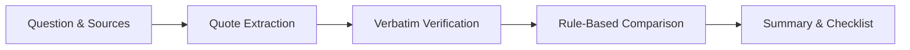

# Digital Dark Spot

An AI-assisted platform that shows what your sources do not tell you: potential gaps, possible conflicts and outdated information, with verbatim evidence and a verify-next checklist.

Built for the Shinchan Online Hackathon 2026.

Demo video: To be added  
Live demo: Not deployed

## Quick Start

```bash
npm install
npm run dev
```

Open `http://localhost:5173`.

No API key is required for the sample scenarios. Select a sample scenario to explore the report.

Live search and AI features require the configured provider keys. API keys belong in `backend/.env`; `.env.example` contains placeholders only. Without a search provider key, the application falls back to manual source input or verified sample scenarios.

## Try It

- **Potential Gaps**: Uncovered critical parameters across reviewed sources.
- **Possible Conflicts**: Contradictory statements showing both source quotes side by side.
- **Freshness Warnings**: Outdated dates or superseded decision cycles flagged with warnings.
- **Evidence Drawer**: Verbatim quotes excerpted directly from the original source text.
- **Verify-Next Checklist**: Prioritized list of open questions and next steps to verify.
- **Distinction of Types**: Clear labels separating Sourced, AI-suggested, and Uncertain information.

## What It Does

- Enter a research question or topic.
- Discover or add source material through search, URLs, or pasted text.
- Identify potential information gaps and unanswered questions.
- Identify possible conflicts and outdated or undated information with source references.
- Produce a prioritized verify-next checklist with clear Sourced, AI-suggested, and Uncertain labels.

## How It Works

1. Discover or ingest sources from live search, URLs, or pasted text excerpts.
2. Extract claims with exact source quotes and target parameters.
3. Verify quotes against source text and discard unsupported claims.
4. Compare information across sources using rule-based comparison.
5. Present the Summary, evidence, findings, and verify-next checklist.



## Evidence & Trust

- Sourced claims contain verbatim evidence from the original source text.
- Unsupported or unmatched claims are discarded and counted during verification.
- Cross-source comparisons use rule-based comparison for identical attributes and entities.
- Expected information can be AI-suggested and edited by the user.
- A verbatim quote proves that the text exists in the source, not that the interpretation is necessarily correct.

Findings are potential signals, not verified facts.

- **Sourced**: Supported by verbatim source evidence.
- **AI-suggested**: Generated as a research suggestion or hypothesis.
- **Uncertain**: Insufficient evidence, conflicting data, or unresolved interpretation.

## Tests

```bash
npm run verify
npm run eval
npm run check:secrets
```

- **Verification**: 17 passed, 1 skipped (optional PDF test), 0 failed (`npm run verify`)
- **Evaluation**: 3/3 deterministic fixture tests passed (`npm run eval`)
- **Secret scan**: 0 secret leaks detected across tracked files (`npm run check:secrets`)

| Scenario | Status | Gaps | Conflicts | Stale Warnings | Claims |
| :--- | :--- | :--- | :--- | :--- | :--- |
| `scenario-1` (Merit Scholarship) | PASSED | 0 | 2 | 1 | 6 |
| `scenario-2` (Clean Energy Scheme) | PASSED | 1 | 0 | 0 | 5 |
| `scenario-3` (Global Fellowship) | PASSED | 0 | 0 | 0 | 8 |

## Limitations

- Some websites may block automated fetching or require JavaScript rendering.
- Search results do not represent the entire web.
- Source extraction can misread context.
- Search and LLM provider rate limits or quotas may be reached on free tiers.
- Findings are potential signals rather than guaranteed facts.
- Dark-mode only interface.
- The system has not been tested at scale.

## Tech Stack & Credits

Built with TypeScript, Node.js, Express, React 19, and Vite. UI components and design use Tailwind CSS, [Watermelon UI](https://ui.watermelon.sh), [Radix UI](https://www.radix-ui.com), [Motion](https://motion.dev), and typography with [Bricolage Grotesque](https://fonts.google.com/specimen/Bricolage+Grotesque) and [DM Sans](https://fonts.google.com/specimen/DM+Sans).
