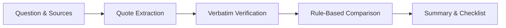

# Digital Dark Spot


An AI-assisted platform that shows what your sources do not tell you: potential gaps, possible conflicts, and earlier-cycle or undated information, with verbatim evidence and a verify-next checklist.

> *[Screenshot / Demo GIF Placeholder]*

Built for the Shinchan Online Hackathon 2026.

Demo video: To be added  
Live demo: Not deployed

## Table of Contents

- [Quick Start](#quick-start)
- [Try It](#try-it)
- [What It Does](#what-it-does)
- [Major Features](#major-features)
- [How It Works](#how-it-works)
- [Evidence & Trust](#evidence--trust)
- [Tests](#tests)
- [Limitations](#limitations)
- [Future Scope](#future-scope)
- [Tech Stack](#tech-stack)

## Quick Start

```bash
npm install
npm run dev
```

Open `http://localhost:5173`.

No API key is required for the sample scenarios. Select a sample scenario to explore the report.

Live search and AI features require the configured provider keys. API keys belong in `backend/.env`; `.env.example` contains placeholders only. Without a search provider key, the application falls back to manual source input or verified sample scenarios.

## Try It

| Capability | Description |
| :--- | :--- |
| **Potential Gaps** | Uncovered critical parameters across reviewed sources. |
| **Possible Conflicts** | Contradictory statements showing both source quotes side by side. |
| **Freshness Warnings** | Earlier-cycle or undated information flagged with warnings. |
| **Evidence Drawer** | Verbatim quotes excerpted directly from the original source text. |
| **Verify-Next Checklist** | Prioritized list of open questions and next steps to verify. |
| **Distinction of Types** | Clear labels separating Sourced, AI-suggested, and Uncertain information. |

## What It Does

- Enter a research question or topic.
- Discover or add source material through search, URLs, or pasted text.
- Identify potential information gaps and unanswered questions.
- Identify possible conflicts and earlier-cycle or undated information with source references.
- Produce a prioritized verify-next checklist with clear Sourced, AI-suggested, and Uncertain labels.

## Major Features

- **Topic-Independent Analysis**: Dynamic decision parameter discovery applicable across technology purchasing, educational programs, public benefits, and complex regulatory questions without hardcoded domain vocabulary.
- **Single Source of Truth Matrix**: Deterministic computation engine providing unified parameter status (corroborated, single source, conflict, gap, or stale) across dashboard metrics, coverage map, executive summary, and action items.
- **Verbatim Evidence Verification**: Exact substring matching rejects non-verbatim claims and hallucinations, maintaining provenance back to the original source text.
- **Low-Text Source Filtering**: Automatic detection and exclusion of video platforms, social media, and login-walled pages from primary review counts.
- **Prioritized Verify-Next Checklist**: Action items prioritized by risk severity (High priority for conflicts, passed deadlines, and critical gaps; Medium priority for single sources and undated documents).
- **Executive Finding & Synthesis**: Short, concise point-by-point takeaways answering the user's inquiry directly alongside structured decision cards.
- **Interactive Evidence Drawer**: Sub-route drawer for deep-diving into verbatim citations, character offsets, and source metadata without losing dashboard context.

## How It Works

1. Discover or ingest sources from live search, URLs, or pasted text excerpts.
2. Extract claims with exact source quotes and target parameters.
3. Verify quotes against source text and discard unsupported claims.
4. Compare information across sources using rule-based comparison.
5. Present the Summary, evidence, findings, and verify-next checklist.



## Evidence & Trust

- Sourced claims contain verbatim evidence from the original source text.
- Unsupported or unmatched claims are discarded and counted during verification.
- Cross-source comparisons use rule-based comparison for identical attributes and entities.
- SSRF-guarded fetching validates all network requests, prohibiting internal network routing and private IP access during URL ingestion.
- Expected information can be AI-suggested and edited by the user.
- A verbatim quote proves that the text exists in the source, not that the interpretation is necessarily correct.

Findings are potential signals, not verified facts.

- **Sourced**: Supported by verbatim source evidence.
- **AI-suggested**: Generated as a research suggestion or hypothesis.
- **Uncertain**: Insufficient evidence, conflicting data, or unresolved interpretation.

## Tests

```bash
npm run verify
npm run eval
npm run check:secrets
```

- **Verification**: 17 passed, 1 skipped (optional PDF test), 0 failed (`npm run verify`)
- **Evaluation**: 3/3 deterministic fixture tests passed (`npm run eval`)
- **Secret scan**: 0 secret leaks detected across tracked files (`npm run check:secrets`)

| Scenario | Status | Gaps | Conflicts | Stale Warnings | Claims |
| :--- | :--- | :--- | :--- | :--- | :--- |
| `scenario-1` (Merit Scholarship) | PASSED | 0 | 2 | 1 | 6 |
| `scenario-2` (Clean Energy Scheme) | PASSED | 1 | 0 | 0 | 5 |
| `scenario-3` (Global Fellowship) | PASSED | 0 | 0 | 0 | 8 |

## Limitations

- Some websites may block automated fetching or require JavaScript rendering.
- Search results do not represent the entire web.
- Source extraction can misread context.
- Search and LLM provider rate limits or quotas may be reached on free tiers.
- Findings are potential signals rather than guaranteed facts.
- Dark-mode only interface.
- The system has not been tested at scale.

## Future Scope

- **Browser Rendering & URL-Context Support**: Full headless browser automation to reliably ingest client-rendered SPAs, interactive documentation, and JavaScript-heavy portals.
- **Multilingual Source Ingestion**: Support for non-English sources with automated translation and cross-lingual claim alignment.
- **Source-Reliability Scoring**: Automated credibility weighting based on domain authority, official institutional status, and publication metadata.
- **Saved Parameter Sets**: Persistent customizable verification templates for recurring decision workflows.
- **PDF Export**: Export comprehensive research reports, evidence matrices, and verify-next checklists to printable PDF documents.

## Tech Stack

- **Frontend**: React 19, TypeScript, Vite, Tailwind CSS, Motion, Radix UI, Watermelon UI
- **Backend**: Node.js, Express, TypeScript
- **Search**: Tavily Search API
- **AI**: Gemini and Groq with provider failover
- **Safety**: SSRF-guarded fetching, server-side env vars, secret scanning
- **Testing**: Deterministic evaluation suite, hackathon scenario tests, secrets leak auditor, domain ban-list scanner
- **Typography**: [Bricolage Grotesque](https://fonts.google.com/specimen/Bricolage+Grotesque), [DM Sans](https://fonts.google.com/specimen/DM+Sans), [JetBrains Mono](https://fonts.google.com/specimen/JetBrains+Mono)
