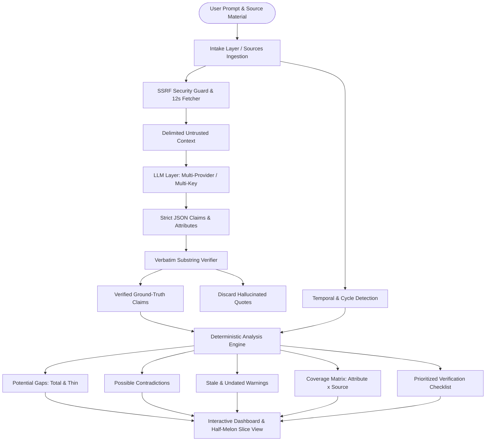

# Digital Dark Spot 🍉
> **AI-Assisted Information Gap & Contradiction Detection Platform**  
> *Built for the Shinchan Online Hackathon 2026 (Devengers)*

[](https://www.typescriptlang.org/)
[](https://react.dev/)
[](https://tailwindcss.com/)
[](https://motion.dev/)
[](https://ui.watermelon.sh)

---

## 1. Overview & Core Philosophy

People rely on online information to make critical decisions about education, careers, public services, research, and business. However, information is scattered across fragmented websites, outdated notices, and conflicting discussion boards.

Standard search engines and AI chatbots summarize what is *available*. **Digital Dark Spot** reveals what is **missing**, **contradicted**, or **outdated** across multiple sources, grounding every finding in verbatim evidence quotes.

> [!IMPORTANT]
> **Core Guarantee:** Potential signals, not verified facts. Digital Dark Spot identifies dark spots and delivers a prioritized checklist to guide human verification before high-stakes decisions.

---

## 2. System Architecture



---

## 3. Technology Stack

- **Frontend (`/client`):**
  - **Framework:** Vite + React + TypeScript
  - **Routing:** React Router v6 (lazy-loaded routes, nested dashboard tab outlets)
  - **Styling:** Tailwind CSS v4 with custom **"Watermelon Seed"** tokens (Light & Dark modes)
  - **Components:** [Watermelon UI](https://ui.watermelon.sh) + Radix UI primitives + shadcn/ui
  - **Motion & Animation:** [Motion](https://motion.dev) (`motion/react`) with `<MotionConfig reducedMotion="user">`
- **Backend (`/server`):**
  - **Runtime:** Node.js + Express (TypeScript with ES modules)
  - **Storage:** In-memory job pipeline and caching
  - **Ingestion:** Cheerio HTML text cleaner, SSRF IPv4/IPv6 guard, temporal cycle regex engine
  - **LLM Engine:** Native REST adapters for Google Gemini, OpenAI, and Anthropic with round-robin multi-key management and failover cooldowns.

---

## 4. Setup & Running

### Prerequisites
- Node.js `v18+` or `v20+` (Tested on Node `v24`)
- npm `v9+`

### Installation
Clone the repository and install all dependencies:
```bash
git clone https://github.com/example/digital-dark-spot.git
cd digital-dark-spot
npm install
```

### Configure Environment Variables
Copy `.env.example` to `.env`:
```bash
cp .env.example .env
```
Edit `.env` with your API keys (comma-separated keys support multi-key round-robin):
```env
PORT=3001
CLIENT_PORT=5173

# LLM Providers Configuration
LLM_PROVIDER_ORDER=gemini,openai,anthropic

# Google Gemini (Optional)
GEMINI_API_KEYS=your_key_1,your_key_2
GEMINI_MODEL=gemini-1.5-flash

# OpenAI (Optional)
OPENAI_API_KEYS=your_sk_key_1
OPENAI_MODEL=gpt-4o-mini

# Anthropic (Optional)
ANTHROPIC_API_KEYS=your_ant_key_1
ANTHROPIC_MODEL=claude-3-5-haiku-20241022
```
*(If no API keys are provided, the entire platform runs seamlessly in offline **Demo Mode** using the precomputed verified scholarship dataset).*

### Run the App (One Command)
Start both backend and frontend concurrently:
```bash
npm run dev
```
- Frontend UI: `http://localhost:5173`
- Backend API: `http://localhost:3001`
- Styleguide: `http://localhost:5173/styleguide`

---

## 5. Automated Test Suites

Run the built-in CLI verification suites:
```bash
# Test LLM multi-key rotation and failover
npm run test:llm

# Test Ingestion SSRF guards and date detection
npm run test:ingestion --workspace=server

# Test Verbatim quote verification and anti-hallucination filter
npm run test:extraction --workspace=server

# Test Deterministic gap, conflict, matrix, and checklist logic
npm run test:analysis --workspace=server

# Test End-to-end hackathon scholarship flow checkpoint
npm run test:checkpoint --workspace=server

# Test Security hardening, prompt injection defense, and bundle audit
npm run test:hardening --workspace=server
```

---

## 6. Suggested Demo Script (Hackathon Walkthrough)

1. Open `http://localhost:5173`.
2. Click **"Try Demo: Fictional Scholarship Dataset"** on the home page.
3. Observe the prefilled prompt: *"What should I verify before applying for this scholarship?"* alongside 3 staged documents (Official 2026 notice, 2024-25 blog, undated forum post).
4. Click **"Slice it open"** — observe the knife slice sweep motion as the analysis pipeline begins.
5. In `/analyzing/sample-scholarship-report`, watch the 5 real stages progress:
   - *Fetching* → *Reading* → *Comparing* → *Checking dates* → *Building checklist*.
6. Arrive at the **Dashboard** (`/report/sample-scholarship-report`):
   - **Hero Moment:** Watch the half-melon slice view fade in with spring seeds.
   - **Metric Strip:** 3 Sources Reviewed, 6 Potential Gaps, 2 Possible Conflicts, 2 Potentially Stale.
   - **Interactive Half-Melon Slice View:** Click any wedge to highlight coverage state.
   - **Accessible Coverage Matrix:** Inspect attribute × source cells with high contrast.
7. Switch to the **Gaps Tab:** Observe how *"renewal_conditions"* is identified as an unmentioned total gap.
8. Switch to the **Conflicts Tab:** Inspect the two-column split cards with the jagged fracture divider showing the $50,000 official income limit vs the $40,000 blog limit.
9. Click **"Inspect Quote Evidence"** to slide open the **Evidence Drawer** over the dashboard, verifying the 100% verbatim substring match.
10. Switch to the **Checklist Tab:** Check off items with interactive seed-to-checkmark animation, click **"Copy as Markdown"**, and download the exported verification `.md` checklist.

---

## 7. Limitations & Future Scope

### Current Limitations
- Web scraping respects robots.txt and blocks complex single-page apps relying on heavy client-side JavaScript rendering without headless browsers.
- In-memory storage clears jobs on server restart (intentional for hackathon lightweight architecture).

### Future Roadmap
- **Browserbase MCP Integration:** Real headless browser extraction for complex JavaScript-heavy portals.
- **Persistent Database:** SQLite / PostgreSQL persistence for user historical reports.
- **Automated Verification Webhook:** Scheduled monitor that alerts users when an information gap is filled by a newly published official notice.

---

## 8. Credits

- **[Watermelon UI](https://ui.watermelon.sh):** Component patterns, design inspiration, and accessible layout primitives.
- **[Motion](https://motion.dev):** GPU-accelerated motion animations, spring mechanics, and layout transitions.
- **[Radix UI](https://www.radix-ui.com):** Accessible WAI-ARIA primitive foundations.
- **[Bricolage Grotesque](https://fonts.google.com/specimen/Bricolage+Grotesque) & [DM Sans](https://fonts.google.com/specimen/DM+Sans):** Typography system.

